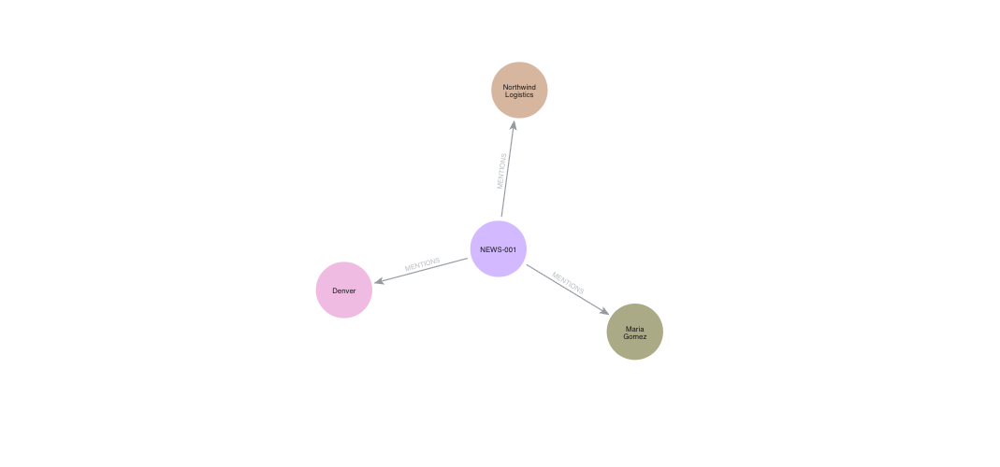
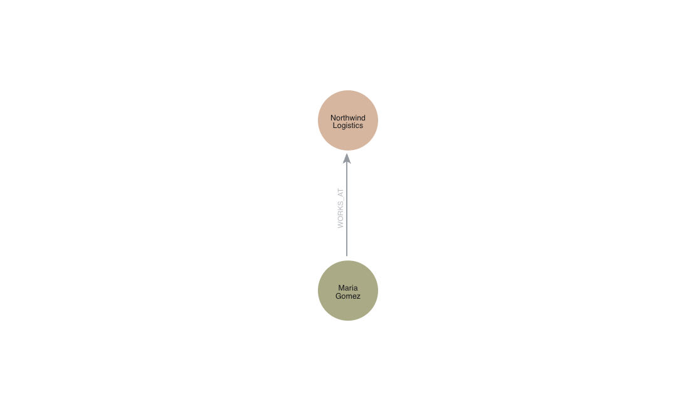

# News Article Entity Extraction

GitHub: https://github.com/sharathxdev/news-article-entity-extraction

This project covers article data cleaning, weekly topic counts, evaluation of an LLM's entity extraction and knowledge graph creation using Neo4j.

## 1. Part A – Data Cleaning and Weekly Counts

The input contains five articles. The first two have duplicate titles, different topic capitalization and different date formats.

I cleaned the data by normalizing titles, topics and dates, removing duplicate titles and reporting invalid or ambiguous records.

For `08/01/2026`, I used August 1 because the duplicate record contains `2026-08-01`. I also flagged this date as ambiguous in the cleaning report.

### Cleaning results

| Description | Count |
|---|---:|
| Input articles | 5 |
| Duplicates removed | 1 |
| Invalid records | 0 |
| Ambiguous dates | 1 |
| Cleaned articles | 4 |

### Weekly article counts

I used ISO calendar weeks for grouping.

| Week | Topic | Article count |
|---|---|---:|
| 2026-W31 | local | 1 |
| 2026-W32 | business | 2 |
| 2026-W32 | sports | 1 |

The duplicate article is counted only once.

## 2. Part B – Entity Extraction Evaluation

The reference entities are:

- Person: Maria Gomez
- Organization: Northwind Logistics
- Location: Denver

The LLM identifies all three names but classifies Denver as an Organization instead of a Location.

### Strict evaluation

Strict evaluation checks both the entity name and its type.

| Metric | Score |
|---|---:|
| True positives | 2 |
| False positives | 1 |
| False negatives | 1 |
| Precision | 0.667 |
| Recall | 0.667 |
| F1 | 0.667 |

Lenient evaluation, which compares names without checking their types, gives an F1 score of 1.0.

The wrong type matters because an incorrect entity type can create false information in a knowledge graph. A missed entity also matters because information is lost.

## 3. Knowledge Graph

I used four node types:

- Article
- Person
- Organization
- Location

The relationships are:

```text
Article -[:MENTIONS]-> Person
Article -[:MENTIONS]-> Organization
Article -[:MENTIONS]-> Location
Person -[:WORKS_AT]-> Organization
```

Maria Gomez is connected to Northwind Logistics through a `WORKS_AT` relationship with the role `CEO`.

I did not create a `LOCATED_IN` relationship between Northwind Logistics and Denver because the article does not establish that the company is located there.

### Graph Visualization

The complete knowledge graph shows the article and its three mentioned entities.



*Figure 1: Article and entity relationships.*

The following visualization shows the WORKS_AT relationship between Maria Gomez and Northwind Logistics.



*Figure 2: Maria Gomez's relationship with Northwind Logistics.*

### Cypher query

The following query finds organizations mentioned in the same article as a given person.

```cypher
MATCH (person:Person {name: $person})
MATCH (article:Article)-[:MENTIONS]->(person)
MATCH (article)-[:MENTIONS]->(organization:Organization)

RETURN DISTINCT
    article.article_id AS article_id,
    organization.name AS organization

ORDER BY article_id, organization;
```

For `Maria Gomez`, the query returns:

| Article | Organization |
|---|---|
| NEWS-001 | Northwind Logistics |

The query uses a parameter, so it can also be used with other person names.

## 4. Running the Project

Python 3.13 was used during development.

Create a virtual environment and install dependencies:

```bash
python3 -m venv .venv
source .venv/bin/activate
python -m pip install -r requirements.txt
```

Run the Python pipeline:

```bash
python -m src.pipeline
```

This runs cleaning, weekly analysis, entity evaluation, graph preparation and tests.

To load the graph into a running Neo4j instance and execute the query:

```bash
python -m src.pipeline --load-neo4j --person "Maria Gomez"
```

The program asks for the Neo4j password without displaying it.

The local Neo4j instance used during development listens on port 7688. For another installation, set the Bolt address before running:

```bash
export NEO4J_URI="bolt://127.0.0.1:7687"
```

The default Neo4j username and database are both `neo4j`.

Run tests separately:

```bash
python -m pytest -q
```

**Test result: 58 passed.**

## 5. Evaluation Clarification and Live Neo4j Verification

### Denver: wrong type versus missing entity

The reference extraction is:
- People: Maria Gomez
- Organizations: Northwind Logistics
- Locations: Denver

The LLM extraction is:
- People: Maria Gomez
- Organizations: Northwind Logistics, Denver
- Locations: none

Denver was extracted, but assigned the wrong type. Strict evaluation counts it as a false positive under Organization and a false negative under Location.

In this example, the wrong type is more harmful to the knowledge graph than a missing entity. A missing entity leaves information out. A wrong type can add a false fact by representing Denver as an Organization instead of a Location. This can mislead graph queries and downstream analysis.

The strict F1 score is 0.667 because it checks both entity names and types. The lenient F1 score is 1.0 because it checks only entity names. This difference shows why name-only evaluation can hide an important classification error.

### Live Neo4j execution result

I ran the loader against my local Neo4j instance using:

    python -m src.graph.neo4j_loader --person "Maria Gomez"

The live graph-loading report was:

    articles_loaded: 1
    entities_loaded: 3
    mentions_loaded: 3
    relationships_loaded: 1

The organization lookup returned:

    Person: Maria Gomez
    Organizations: ['Northwind Logistics']

This result was obtained by executing the query against the running Neo4j database, not only through an automated test.

## 6. Limitations and Next Steps

### Limitations

- The supplied dataset contains only five articles, so the results demonstrate the pipeline on a small example.
- The entity evaluation uses one reference extraction and one LLM extraction. These scores are not a broad benchmark of entity extraction quality.
- The graph relationships are based on supplied annotations. The current example does not automatically discover every possible relationship.
- Deduplication uses normalized article titles because stable article IDs are not supplied. Two different articles with the same title could therefore be treated as duplicates.

### Next Steps

- Test the cleaning and weekly analysis pipeline on a larger news dataset.
- Evaluate more entity extraction examples, including wrong types, missed entities and incorrect boundaries.
- Add more evidence-supported relationship examples and test additional graph queries.
- Evaluate extraction and graph results against a larger annotated dataset.

## 7. AI Tool Usage

ChatGPT was used as a development assistant for implementation guidance, debugging, reviewing explanations and improving project documentation.

I ran the project commands locally, inspected the generated outputs, executed the automated tests and verified the organization lookup against the running Neo4j database. I am responsible for understanding and explaining the implementation, its results and the decisions made in this project.
